# CVMaker

Finds software developer jobs in the countries you choose, plus fully remote jobs, from job boards and directly from company career pages. Then it uses Claude to tailor your CV to the job you pick.

## Screenshots

The screenshots use a made-up demo profile ("Alex Morgan") and fictional companies.

**Jobs**: the app shell (sidebar, quick search, notifications, person menu, light/dark toggle), the dashboard (new jobs, applications, response rate, follow-ups, median salary), company logos, Claude fit and keyword scores, salary converted to € per month, and what your feedback taught ("↑ Sofia").

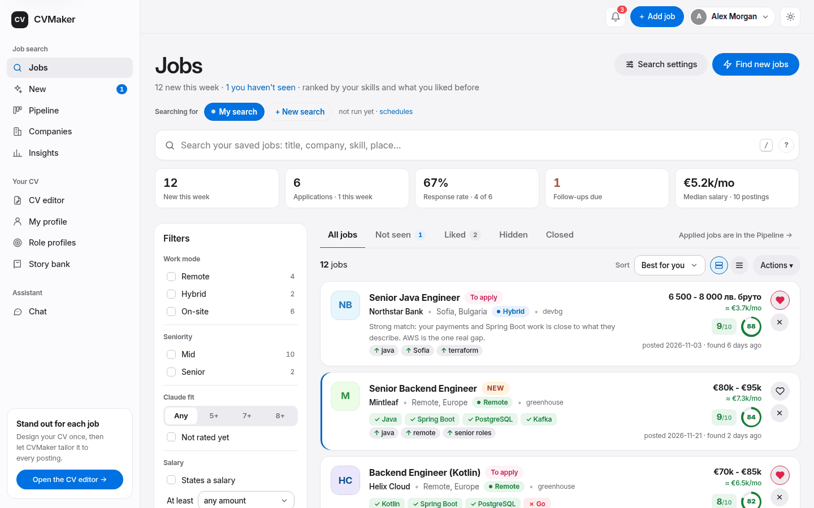

**Dark theme**: every page, the CV editor included, follows the system theme or the toggle in the top bar.

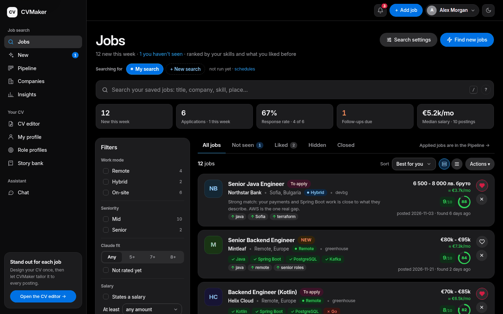

**Job page**: the posting with headings and bullets recovered, a **Next step** box, your progress, and tabs for fit, CV & letter, application, outreach, interview, offer and GitHub.

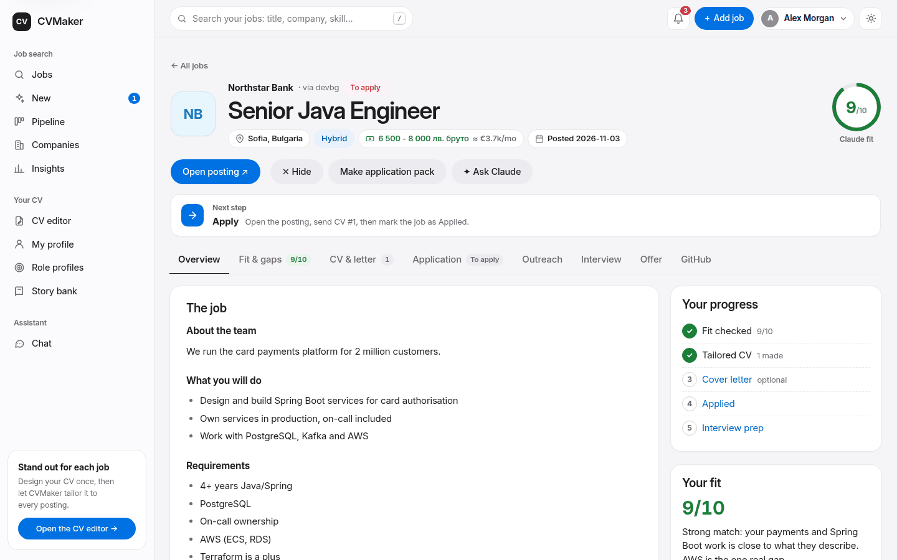

**Fit & gaps**: Claude's full fit check, with what helps you, what counts against you, and how to close each gap.

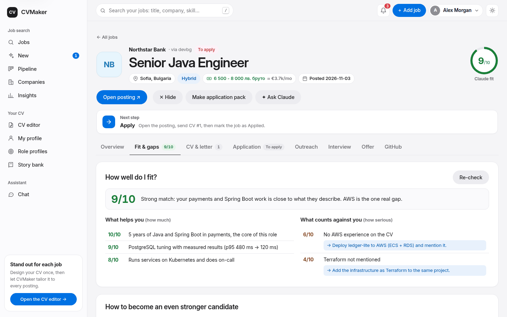

**Tailored CV**: one-page preview drawn by the CV editor, layout controls, the requirements you match and those your profile doesn't show.

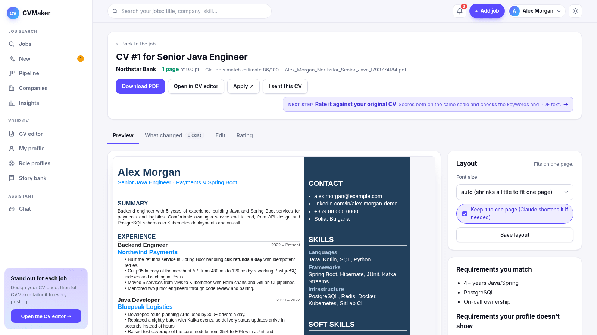

**CV editor**: click anything on the page and the toolbar changes it (font, size, colour, spacing, box size, ✦ Rewrite with Claude); templates, elements, text, uploads, layout, versions, layers and history on the left.

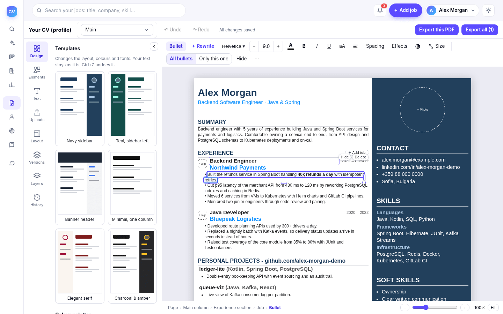

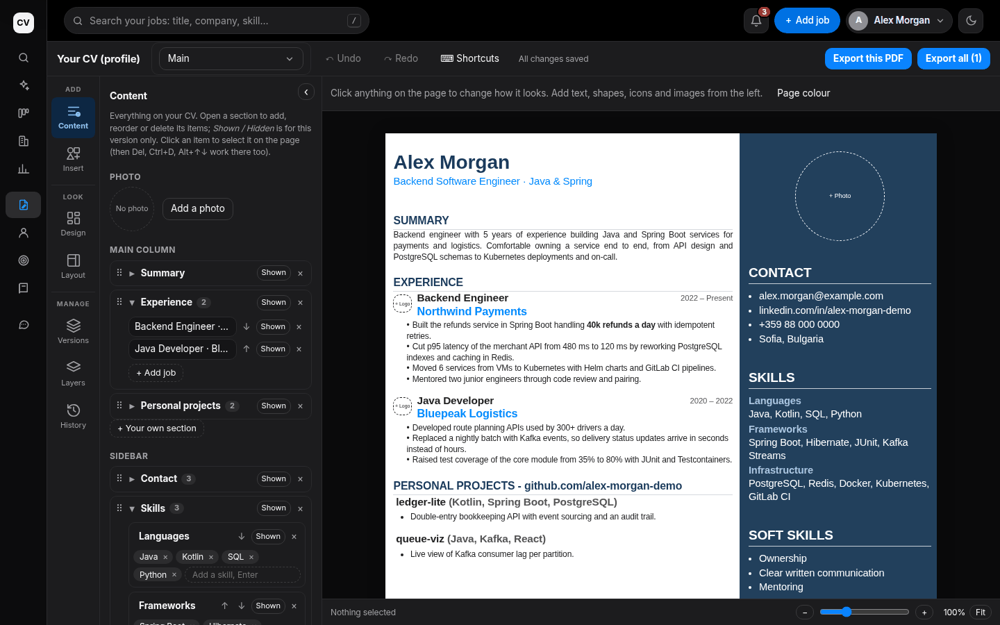

**Pipeline**: applications from To apply to Offer, Rejected or Ghosted, with response rates (with and without a tailored CV) and follow-ups due.

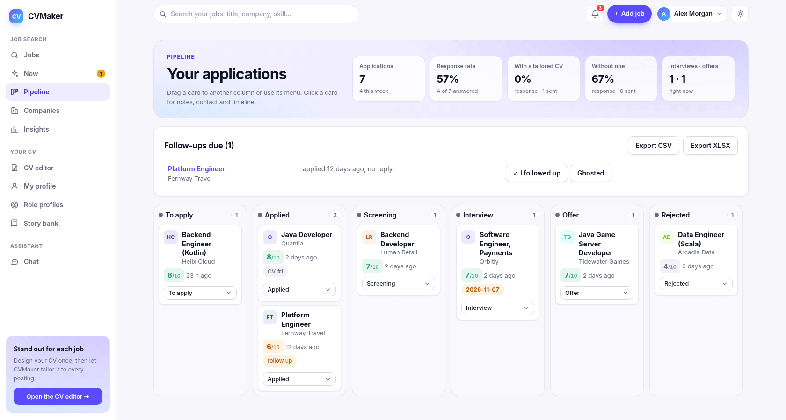

**Notifications**: new jobs, follow-ups due, closed postings and finished background tasks.

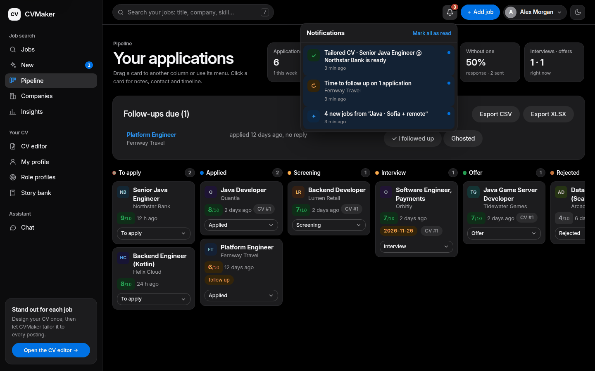

**Insights, Your gaps**: the gaps from all your fit checks grouped and ranked by how many jobs they affect, plus the skills your jobs ask for that your profile never mentions.

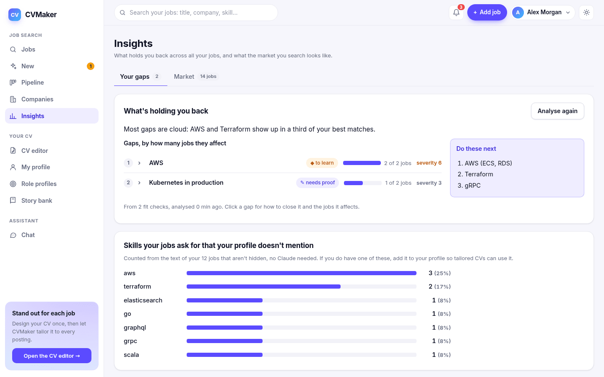

**Insights, Market**: most requested skills (and whether you have them), salaries by seniority and place, and postings per week.

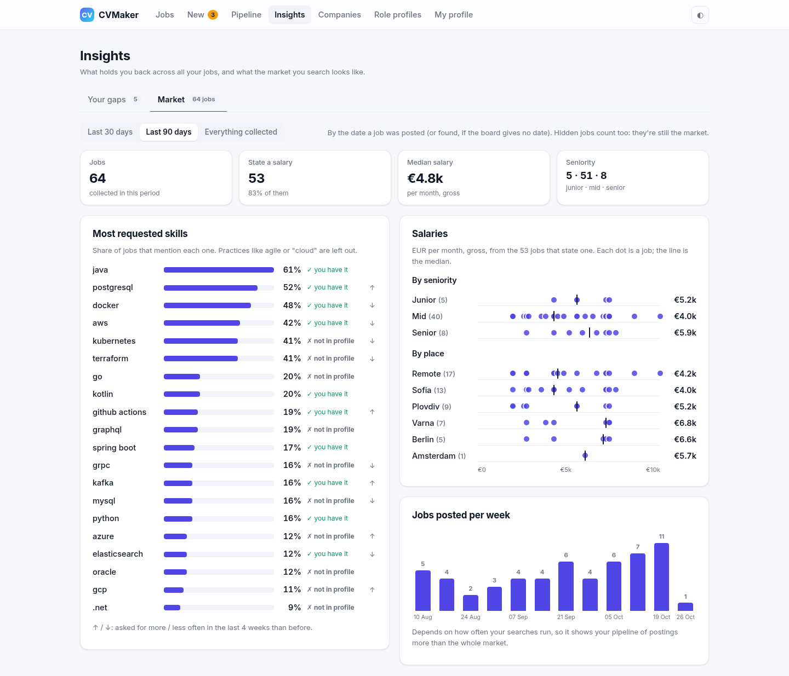

**Chat**: ask Claude about your CV or a job; profile changes are shown line by line and only saved when you apply them.

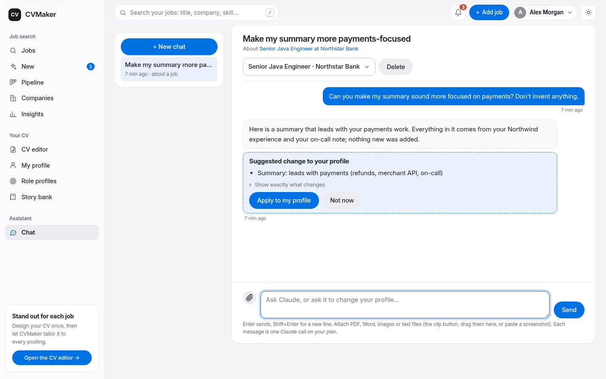

**Story bank**: STAR+R stories for interviews, drafted from your profile, with the details only you can add marked.

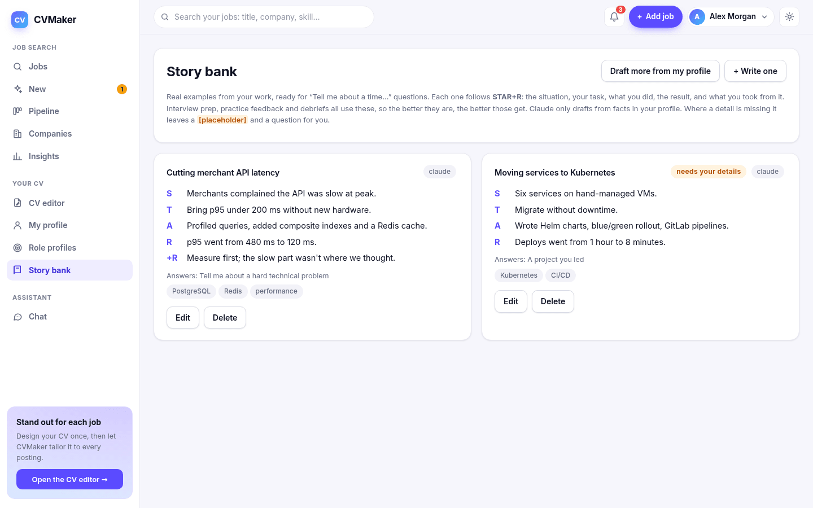

**Add a job by link or text**, then check your fit, tailor a CV or make a full application pack.

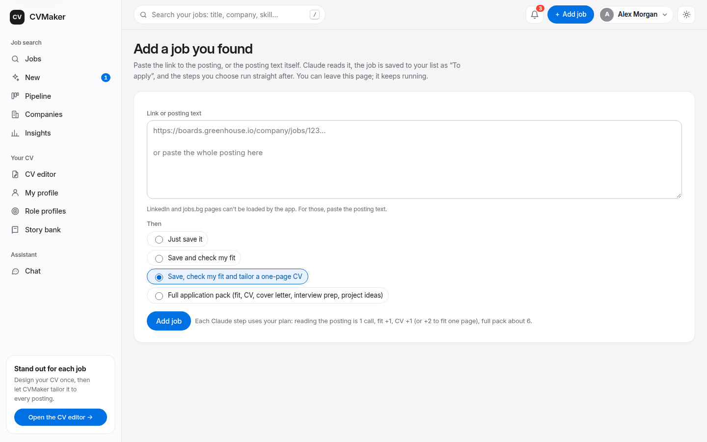

**History & backup**: restore points before profile and editor changes, and a one-zip backup of everything.

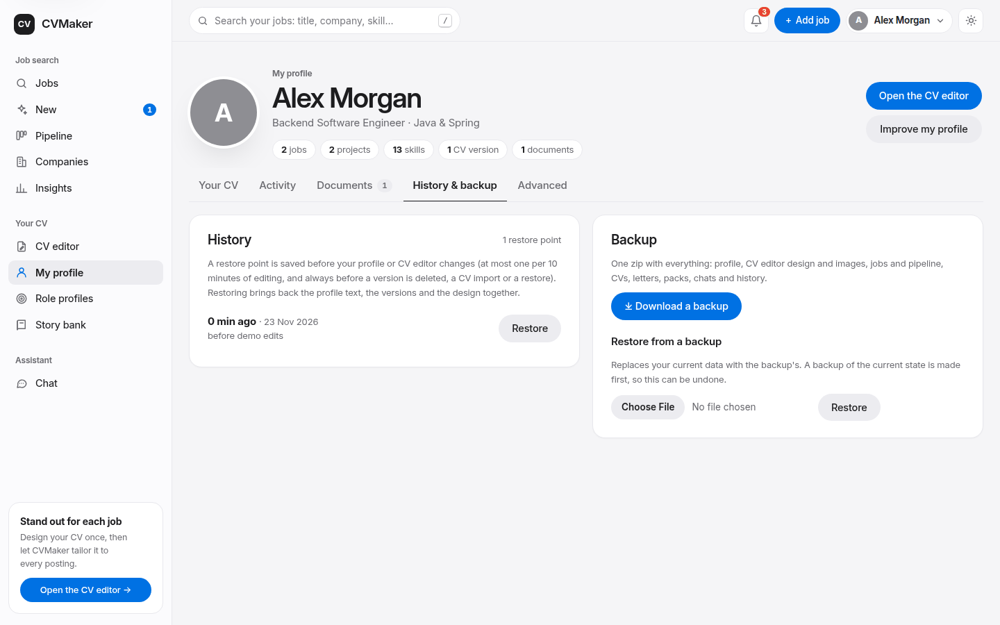

## Setup

CVMaker runs in two modes from the same code (`CVMAKER_MODE`):

| | **Desktop** (default) | **Server** (hosted, for later) |
|---|---|---|
| Who | One person on their own computer | Many people with accounts |
| Login | None; it only answers on 127.0.0.1 | Email + password, emailed login links, Google sign-in |
| AI | The user's **own Anthropic API key** (Settings → API keys) | The operator's key, metered per plan; users may add their own |
| Data | A folder on the computer | One folder per account under `data/accounts/`, Postgres or SQLite for accounts and the task queue |
| Payment | Free | Stripe (off until configured) |

### Desktop app

```bash
uv sync                      # once (add --extra desktop for a native window via pywebview)
uv run cvmaker               # starts it and opens a window
```

`cvmaker` starts the app on a free port on 127.0.0.1 and opens it in its own window: a native window with pywebview installed, otherwise Chrome/Chromium/Edge in app mode, otherwise the default browser. Starting it again opens the one that's running. Data goes to the system's per-user folder (`~/.local/share/CVMaker`, `~/Library/Application Support/CVMaker`, `%APPDATA%\CVMaker`). In a source checkout that already has `data/`, it uses `data/`.

On first start every page shows "Add your Anthropic API key". The user pastes their key in **Settings → API keys**, where *Test the Anthropic key* checks it. Keys are stored encrypted on that computer. Job-board keys (JSearch, Adzuna) and GitHub go there too.

For development, `./run.sh` runs the same app with auto-reload on http://127.0.0.1:8000. Setting `CVMAKER_BACKEND=claude-code` in `.env` still routes Claude calls through your local Claude Code login. It's desktop only and for personal use; server mode refuses it.

Requirements: Python 3.12 (installed with `uv`) and Google Chrome or Chromium. Chrome loads JavaScript-heavy career pages and prints the CVs to PDF.

### Server mode

```bash
cp .env.example .env         # fill in the "Server mode" section: secret key, public URL, Postgres password, email…
docker compose up -d         # web + worker + Postgres; put a TLS proxy (Caddy/Traefik/nginx) in front of :8000
```

- **Accounts:** `/signup` (email confirmation required before use), `/login`, emailed login links, password reset, Google sign-in (with `GOOGLE_CLIENT_ID`/`SECRET`). Passwords are scrypt hashes. Session and email tokens are random, and only their hashes are stored.
- **Keeping users apart:** the account comes only from the session cookie. All data paths go through `people.account_root()`, so each account lives in its own folder. "People" are profiles inside an account, and the person cookie only picks people of that account.
- **AI:** simple work uses cheaper models (`fast` = Haiku: rating many jobs, reading postings and career pages; `standard` = Sonnet: reviews, analysis, chat, CV import). Opus is kept for what goes to employers (tailored CVs, letters, prep, offers). Every call is metered per account. Plans get a monthly token allowance (`CVMAKER_FREE_TOKENS`, `CVMAKER_PRO_TOKENS`) and a per-minute limit. Users with their own key aren't limited.
- **Background tasks** are a queue in the central database and survive restarts: `python -m cvmaker.worker 4 --scheduler`. A task whose worker dies is picked up again when its lease runs out. Scheduled searches per account are capped by plan.
- **Billing:** Stripe Checkout, Customer Portal and a signed webhook (`/billing/webhook`). Turn on Stripe Tax for EU VAT.
- **Email:** Resend, Postmark or SMTP (`CVMAKER_MAIL`). `console` writes emails to `data/outbox/` for development.
- **Backups:** every account and person is backed up automatically (`CVMAKER_BACKUP_EVERY_HOURS`) and copied to S3-compatible storage when `S3_BUCKET` is set.
- **GDPR:** Settings → *Download all my data* (a zip of everything, account details and AI usage included) and *Delete my account* (data, sessions and S3 backups go at once, or after `CVMAKER_DELETED_RETENTION_DAYS`). Privacy, terms and cookie pages are at `/legal/…` and use `CVMAKER_OPERATOR*`. **Have them checked by a lawyer before launch.**

### Security (both modes)

- **Host check and CSRF:** the app only answers to its own host names (desktop: localhost, which stops DNS rebinding). Anything that changes data must come from the app's own pages (Origin/Referer check). Cookies are HttpOnly and SameSite=Lax, and security headers are on every response.
- **Fetching links:** the page fetcher refuses private and local addresses (also after redirects), odd ports and non-http schemes.
- **Chrome:** it keeps its sandbox. `CVMAKER_CHROME_NO_SANDBOX=1` is only for containers that can't run it. Pages printed to PDF get a Content-Security-Policy, so nothing in a CV can load local files or reach the network.
- **Uploads:** size limits, the real type is checked from the content, pictures are decoded and saved again by Pillow, zip bombs are refused, and uploaded files are served sandboxed.
- **Prompt injection:** job postings, web pages and GitHub text go to Claude wrapped as untrusted data, with an instruction never to follow what's inside.

### Tests

```bash
uv run pytest                                   # server mode, desktop mode (subprocess), PDF export if Chrome is installed
CVMAKER_TEST_DATABASE_URL=postgresql://… uv run pytest   # the same against Postgres
```

They cover:
- users can't reach each other's data;
- sign-up, verification, login, reset and login links;
- CSRF and host checks;
- the private-address block;
- upload checks;
- the editor round trip and PDF export;
- data export and account deletion;
- Stripe webhooks;
- usage limits;
- tasks surviving a restart.

## How it works

1. **Profile** (`/profile`): the only source of facts for your CVs. Three ways to start:
   - **Import your CV**: a PDF, Word file (.docx), text file or a photo of it, in any layout. Claude maps it onto the profile; sections the profile has no field for (certifications, awards, volunteering, publications, courses, references…) are kept as **custom sections** with the CV's own headings, and extra contact lines (website, address…) are kept too.
   - **Start a blank CV for a kind of job**: software developer, Java, frontend, Python/data, DevOps/cloud, QA/manual tester, automation tester, project manager, product manager, business analyst, data analyst, UI/UX designer, IT support, or other. The category only sets the structure: its skill groups (e.g. *Automation frameworks*, *API testing*, *CI/CD* for an automation tester), extra sections such as *Certifications*, and headings. Nothing is written for you: every field is empty and labelled in the editor (*Job title*, *Company*, *What you did and the result it had*…), and you can rename, add or remove anything.
   - Or edit `data/profile.json` directly.
2. **Interview**: Claude asks about gaps in your profile, either in general or for a specific job. Your answers are added to the profile.
3. **Search** (`/`): pick one or more **kinds of job** (software developer, Java, frontend, Python/data, DevOps/cloud, QA/manual tester, automation tester, project manager, product manager, business analyst, data analyst, UI/UX designer, IT support). Each adds its usual job titles, its skills for ranking, and its own phrases for searching the job boards (e.g. "qa automation engineer", "scrum master"); an excluded word a picked kind needs ("manager" for project managers) is not applied to it. The list lives in `cvmaker/categories.py` and is the same one a blank CV starts from. Add your own title keywords, skills and countries (type and press Enter to add a chip; suggestions come from your profile) and whether remote jobs count. Exclusions, remote regions, posting age, minimum keyword score, sources and the schedule are under "Advanced". Save several **searches**, each with its own name, filters and schedule. A search runs in the background: each source is ticked off live as it answers, and the list updates when it's done. The list can be sorted by Claude fit, keyword score, job title, newly found, posted date, salary or company (click the Fit, Keywords, Job or Salary column header; click again to reverse), and exported to CSV or XLSX in the same order.
   - **Claude fit rating**: after each search, Claude rates the top 40 new jobs (configurable) for fit 1-10, in batches of 5, with a one-line "✓ strong · ✗ missing" summary in the list. "Rate N with Claude" rates the unrated jobs in the current view. The full fit check on a job page replaces the quick rating.
   - **Learning from your feedback**: the ✕ on a job asks why you're hiding it (too senior, too junior, wrong tech stack, wrong location, salary, not this company, not relevant). Those reasons and the jobs you like or move into the pipeline become a "taste" score per job: the **for you** sort combines Claude's fit, the keyword score and that taste, and each job shows why it moved ("↓ senior roles", "↑ Sofia"). Claude's fit ratings get the same feedback, and say when a job looks like ones you've hidden. "Not this company" hides all its jobs and blocks it from future searches (unblock on the jobs page). When a pattern repeats, e.g. 2+ jobs hidden as too senior, the jobs page offers a one-click filter change for your search.
   - **Dashboard strip**: new jobs this week, applications, response rate, follow-ups due, and the median salary seen (converted to ≈ € per month: yearly/hourly amounts and other currencies are converted with fixed rates, so salaries can be compared and sorted; net and gross are not converted).
4. **Salary**: shown whenever a posting states one. It comes from the source's salary fields where they exist (Ashby, Lever, Recruitee, Himalayas, Jobicy, dev.bg, Adzuna, Remotive, RemoteOK, JSearch); otherwise it is picked out of the posting text (e.g. "€62,000 to €87,200", "4 500 - 6 000 лв. бруто").
5. **Automatic search**: in a search's "Advanced" section, turn on "run it automatically every N hours". Newly found jobs are marked **NEW** until you open them or press "Mark all as seen"; the header shows how many there are, and a desktop notification is sent (`notify-send`, desktop mode). Schedules run while the app is open (server mode: in the worker). To search while it is closed, add a cron job, e.g. `0 */6 * * * cd ~/Personal/Projects/CVMaker && ~/.local/bin/uv run python -m cvmaker.auto` (runs every scheduled search, then rates the new jobs).
   - **Application packs**: after each search (scheduled or not), the jobs with a keyword score of at least 80 that have no pack yet get one, up to 3 per search. A pack is a fit check, a GitHub review with project ideas to build for that job, a tailored one-page CV, a matching cover letter and interview prep, made in that order (about 5 Claude calls). Each is saved in the app as usual and copied to `data/packs/<company>_<title>/` (`CV.pdf`, `CoverLetter.pdf`, `PACK.md` with the fit, gaps, projects to build, action plan and interview prep). Change the score, the number per search or switch it off under "Schedules & Claude rating" (stored in `data/prefs.json` as `pack_min_score`, `pack_max`, `pack_after_search`). Any job can get one with **Make application pack** on its page. Ready packs are listed on the jobs page.
   - **Telegram** (desktop mode): set it up under Settings → Telegram by creating a bot with @BotFather, pasting its token and tapping Start on the one-time link. Each day at your chosen time the bot sends new jobs at or above your chosen Claude rating (default 7/10) and any follow-ups due, each job with Open, Hide, Tailor CV and Suggest changes buttons. Tailor CV sends the PDF with what changed and anything the checks couldn't back up. Write to the bot like the chat page, e.g. "shorten my summary": a profile change is only saved when you tap Apply, and can be undone. Jobs rated 9+ (your choice) are sent as soon as they're rated, silently between 22:00 and 08:00. A Cover letter button sends a letter that matches the job's latest CV. You can also send a PDF, Word file, photo or text file, with your question as the caption (same limits as the chat page). Commands: `/jobs`, `/suggest`, `/new`, `/unlink`. The bot asks Telegram for messages, so no port is opened, and it answers only the linked account. It runs only while the app is running (a summary missed while it was closed goes out when it next starts that day; on Linux, Settings → Start at login runs the app in the background from login, at `http://127.0.0.1:8000`, and `./run.sh` stops that copy first), and jobs only arrive if a saved search runs on a schedule. Job details, messages, CVs and PDFs pass through Telegram, and bot chats aren't end-to-end encrypted.
6. **Applications** (`/pipeline` and the job page): move a job through To apply → Applied → Screening → Interview → Offer / Rejected / Ghosted, with a date and a note; each move is kept on the job's timeline. Each job has notes, a recruiter/contact, a next date, and which CV and cover letter you sent ("I sent this CV" on a CV page). The pipeline board supports drag and drop. Jobs still at "Applied" after 10 days (`CVMAKER_FOLLOW_UP_DAYS`) show as follow-ups due, with a desktop notification. The pipeline compares response rates with and without a tailored CV sent. Jobs at a company you applied to before are flagged ("applied 2× · last: rejected").
7. **Background tasks**: searches, ratings and everything Claude writes (fit check, CV, letter, prep, CV rating, interview questions, CV import) run in the background, up to 4 at a time (`CVMAKER_TASK_WORKERS`). You can keep using the app; the header shows what's running, a notice appears when something finishes, and **My profile → Activity** lists every task with its job and a link to the result (**My documents** lists every CV and letter). Restarting the app stops running tasks; they are marked "interrupted".
8. **Per job**: the job page is split into tabs (Overview, Fit & gaps, CV & letter, Application, Interview prep, GitHub), with a **Next step** box at the top worked out from what's done so far. The Overview shows the posting (headings and bullets recovered from the plain text) next to your progress and fit summary. Check your fit, then **generate a tailored CV**. Claude reorders and rewords your profile for the posting and renders a PDF in your CV's design. Requirements you don't meet are listed separately and are never put into the CV. With "Must fit on one page" (on by default), a CV that still runs over after the font shrinks is shortened by Claude. You can also pick the font size (8.4-10.8 pt). On the CV page:
   - The CV page has tabs too (Preview, What changed, Edit, Rating) and its own **Next step** (check unsupported facts, fit one page, rate it, apply, record it as sent).
   - **What changed from your base CV**: every bullet marked kept, reworded (word diff), new or dropped, plus added/removed skills. Skills and numbers that can't be found anywhere in your profile are flagged at the top.
   - **Edit this CV**: change the headline, summary, bullets and skills (or the whole CV as JSON); saving re-renders the PDF.
   - **Layout**: change the font size or the one-page setting at any time.
9. **Rate the CV** (on the CV page): scores the tailored CV and your original (or another CV for the same job) on the same scale: overall chance of an interview, six categories, what improved and what got worse. Two checks are measured, not judged by Claude: which of the posting's keywords each version contains, and an ATS check of the PDF's text layer (name, email, phone, job titles and keywords readable by screening software). Scores vary a little between runs, so compare the two versions within one rating.
10. **Cover letter** (job page): in English, Bulgarian or German, choice of tone and length, based on your profile or a tailored CV. Edit the text on the letter page; saving re-renders the PDF. Requirements you don't meet are listed as "not claimed".
11. **Interview prep** (job page): likely questions by category with answer outlines from your own experience, STAR stories, topics to revise by priority, honest answers for your gaps, and questions to ask them.
12. **Insights** (`/insights`):
   - **Your gaps**: Claude groups the gaps from all your fit checks (full and quick) into a ranked list: how many jobs each one affects, whether it's something to learn or something you have but need to prove on your CV, how to close it, and what to do next. It also lists the tech terms your jobs ask for that your profile never mentions (counted from posting text, no Claude needed).
   - **Market**: from the collected jobs (last 30/90 days or everything, hidden ones included): the most requested skills with whether you have each and whether it's rising or falling over the last 4 weeks, salaries by seniority and place (each job a dot, with the median), and postings per week.
13. **Jobs list density**: Comfortable shows the fit notes and feedback chips under each job; Compact shows one line per job. The choice is remembered in your browser.
14. **Multiple people** (`/people`, or the person menu in the top bar): run job searches for a friend or partner from the same app. Each person has their own profile, photo, jobs, CVs, cover letters, applications, saved searches and schedules, role profiles and learned preferences. The company list (`companies.yaml`) and the API keys in Settings are shared by the people of one account. Your original data stays in `data/` as the default person; everyone else lives in `data/people/<id>/`. The browser remembers who is selected, and the person menu turns orange while you're working for someone else. Background tasks and scheduled searches always work for the person who started them, and their notifications start with that person's name. GitHub checks use the GitHub link in each person's profile (the GitHub username in Settings only applies to the default person). Removing a person moves their folder to `data/people/.removed/` instead of deleting it.
15. **Add a job by link or text** (`/add`, or **+ Add job** in the top bar): paste a posting's link or its text. Claude reads it, the job is saved as "To apply", and then (your choice) your fit is checked, a one-page CV is tailored, or a full application pack is made. LinkedIn and jobs.bg pages are not loaded; paste their text instead.
16. **Posting checks** (the *Posting check* box on a job's overview):
    - **Still open?** Asked through the job board's own API (Greenhouse, Lever, Ashby, SmartRecruiters, Workable), otherwise by loading the posting and looking for 404/410, expired redirects or "no longer accepting applications" wording.
    - **Closed postings** leave the jobs list and go to a **Closed** tab; jobs you applied to stay in the pipeline. A job that shows up again in a search is reopened.
    - **Automatic checks:** after each search, the jobs you haven't applied to are checked (an option in *Schedules & Claude rating*). The **Check they're still open** button above the list checks them on demand.
    - **Warning signs, found without Claude:** reposts (same title at the same company, refreshed posting dates, roles open for months), work-permit wording ("must be authorized to work in…", "no visa sponsorship", citizenship, clearance), compared with your location, and scam signs (fees, bank details, chat-app interviews).
    - **Deeper check with Claude:** weighs it all and gives a 1-10 trust score.
17. **Outreach** (job page → Outreach): names and e-mails found in the posting, the people worth finding (with links that open LinkedIn's own people search), and drafts of a LinkedIn connection note (300 characters at most, with a counter), a message for after they accept, an application e-mail and a follow-up e-mail. Copy them or open them in your e-mail app. The app never sends anything.
18. **Interview stage** (job page → Interview, and **Story bank** in the top bar):
    - **Story bank** (`/stories`): STAR+R stories (situation, task, action, result, reflection) drafted by Claude from your profile, with [placeholders] and questions where only you know the details. Interview prep and practice use them.
    - **Practice** (`/practice/<job>`): answer a question from your prep, a new one from Claude, or one you were asked. You get a 1-10 grade, what worked, what to fix, a stronger answer built from your own facts, and the likely follow-up question.
    - **Debriefs:** after each interview, note the round, interviewers, questions and how it went. Claude says what to improve, what the next round will dig into, suggests new stories for the bank, and drafts a thank-you note. Each debrief is added to the job's timeline.
19. **Offer review** (job page → Offer): paste or upload (PDF) an offer or contract. Claude lists the terms, flags clauses red/amber/green with what to ask, notes what is missing, compares the pay with salaries the app has seen for similar titles, suggests what to negotiate (with wording), and drafts a reply. It's a careful second read, not legal advice.
20. **Skill check** (no AI): every technology a tailored CV, cover letter, outreach draft, thank-you note or offer reply mentions must be in your profile (skills, experience, projects, interview facts) or your GitHub repos (language, topics, README, files such as `Dockerfile` or `pom.xml`). Anything else is flagged with the sentence it's in, on the CV's *Changes* tab, the letter page and under each draft. Saying you haven't used something ("I have not yet worked with Angular") counts as honest. Naming the job's title or company isn't a claim. If a flagged skill is true, **It's true, add to my skills** adds it to your profile so it stops being flagged.
21. **Chat** (*Chat* in the top bar, or *Ask Claude* on a job page): ask Claude anything about your CV, your job search or one job. For a job it also sees the posting, your stage and notes, the fit check, and the latest CV and letter made for it. Ask it to change your profile (your original CV) and it suggests the change, showing each line that would be added or removed. Nothing is saved until you click **Apply to my profile**, and **Undo** puts it back. If you edited your profile in the meantime, an older suggestion is refused rather than overwriting your edits. You can attach files (PDF, Word, images, text: a CV, a posting, an offer, a screenshot) with the clip button, by dragging them in, or by pasting a screenshot. Claude reads them, and earlier attachments stay readable later in the same chat. Each message is one Claude call on your plan.
22. **CV editor** (*CV editor* in the sidebar, or *Open in CV editor* on a tailored CV; it opens inside CVMaker's own page and follows its light/dark theme): edit your CV on the page and keep several versions of it (for example Sofia / Plovdiv, experience first / projects first). It works like Canva:
    - **Click anything** on the page (a name, a job role, a bullet, a section, the sidebar, the page) and the bar above the page changes it: font, size, colour, bold / italic / underline / uppercase, alignment, letter and line spacing, background, padding, corners, border, transparency. A change applies to all elements of that kind (all job roles) or, with *Only this one*, to just that one. The path at the bottom left selects the element's parents. Right-click or the toolbar copies and pastes a style; *Reset* goes back to the template's look.
    - **Templates:** 16 built-in designs (sidebar, banner, one-column, ATS-friendly plain, classic serif, executive, compact…). Adjust any of them, then **Save the current design as a template** to reuse it; your templates are listed first under *Design*.
    - **Empty parts never print:** a section, job, entry or line with nothing in it is left out of the PDF (in the editor it shows its labels and an "Empty" note), so a short CV doesn't show empty headings.
    - **Add a section** (*Content* tab): Certifications, Courses, Awards, Volunteering, Publications, Conferences & talks, Achievements, References or your own heading. Each entry has a title, subtitle (issuer or organisation), date and optional details; sections move between columns and hide per version like the others.
    - **Left rail, in three groups:** *Add*: **Content** (every section with its items: add, delete, reorder, show/hide per version; skill groups and short lists as chips, so a new group or a new item is one click; the photo: add, change, remove; add a section) and **Insert** (*CV parts*: the profile photo, plus any section, the sidebar or logo spots you deleted, to put back; then text boxes, shapes, lines, icons, your images). *Look*: **Design** (your templates, templates, colour palettes, font pairs) and **Layout** (sidebar left / right / none, name across the full width, photo position, heading and bullet styles, contact icons, page colour, text size and spacing, base colours). *Manage*: **Versions**, **Layers**, **Job match**, **History**.
    - **Select with the mouse, like Canva:** click selects; drag on an empty spot (the grey area or blank space on the page) draws a selection box that picks everything it touches (sections only when fully inside); Shift+click adds or removes one. With several selected, the toolbar offers *Delete all* and *Hide in this version*, free objects move together when you drag one, and the arrow keys nudge them.
    - **Move anything anywhere:** drag any part of the CV (the name, a contact line, a heading, a whole job or section, the photo, a column) and drop it anywhere on the page; the rest of the page stays where it is, like in Canva. Press inside something selected to drag all of it (select a job, then drag it by its title); a click without dragging goes one level in. Arrow keys nudge (Shift: 5 mm). Near its own place it snaps back (Alt: no snapping). *↺ Put back* in the toolbar or the right-click menu returns it to where the layout puts it. Moves are saved with the design, so they show in every version and in the PDF. Several selected things (drag a box, or Shift+click) move together.
    - **Select, then edit (like Canva):** one click on any text selects it without a typing cursor, so `Del` deletes it (a contact line or bullet is removed, other text is emptied). Click it again, double-click, press `Enter` or just start typing to edit it; `Esc` stops typing and keeps it selected.
    - **Delete anything:** select it and press `Del` (or the toolbar's *Delete*): items are deleted, text fields emptied, a built-in section (Summary, Experience…) or the sidebar is taken off the page (Content → *Shown* or Layout brings it back), the header's name and title are cleared, and the photo or a job's logo is deleted together with its spot (Content → *Add a photo*, or *+ Logo* on the job, brings it back). Every deletion shows a "Deleted … · Undo" notice.
    - **Items on the page:** a selected job, project, skill group, education entry, entry, bullet, list item, contact line or section also gets *+ Add below*, *Duplicate* and *↑ ↓*; inside an item's text, *⬑ Whole job* (or `Esc`) selects the item. Shortcuts: `Ctrl+D` duplicates, `Ctrl+Enter` adds a new one below, `Alt+↑/↓` moves, `H` hides it in this version, `Esc` goes one level up. `?` or *⌨ Shortcuts* lists them all.
    - **Your own section:** hover a section and click *+ Your own section below* on its bottom edge (or *+ Your own section* under each column in *Content*), then type its heading.
    - **Images: select first, then add.** Clicking the photo or a logo spot selects it; *+ Add photo* in the toolbar (or a double-click) picks the image. Uploaded images go to your images; click one to select it, then *Add to page*, *Use as photo* or *Delete* (refused while the CV still uses it).
    - **Photo:** add, change or remove it in *Content* (or on *My profile*, where *Remove photo* takes it off every CV).
    - **Free elements** (text boxes, shapes, lines, icons, images) go anywhere: drag to move (they snap to the page centre and edges, the sidebar and each other; Alt turns snapping off), handles to resize, ⟳ to rotate, double-click a text box to type. Arrow keys nudge (Shift for 5 mm), `Ctrl+D` duplicates, `Del` deletes, `Ctrl+C`/`Ctrl+V` copy and paste, `Ctrl+]`/`Ctrl+[` change the layer. *Position* puts an element behind the CV text, aligns it to the page or sets exact mm values; *Lock* stops it moving. *Hide* hides one in the current version only.
    - **Box size:** select any element and drag the handles on its right and bottom edge (or use *Size* in the toolbar; *Auto* undoes it). Dragging the sidebar's inner edge changes the sidebar width.
    - **✦ Rewrite** (toolbar, on a bullet, the summary, the title, a skill list or a text box): Claude offers 2-3 versions (*Shorter*, *Add numbers*, *Stronger verbs*, *Fit this job* on a tailored CV, or your own instruction), using only facts from your profile; nothing changes until you pick one.
    - **Job match** (tailored CVs): the posting's key skills, ticked when the CV shows them, live as you edit; a missing one points to a hidden item that mentions it, or to the Skills section.
    - **History**: a restore point is kept before your profile or editor changes (at most one per 10 minutes of editing; always before a version is deleted, a CVEditor import or a restore). Restore from the editor's History tab or *My profile → History & backup*.
    - Sections can move between the main column and the sidebar (select a section → ⇄ Other column), per version. Undo / redo (`Ctrl+Z` / `Ctrl+Shift+Z`) cover everything; zoom is at the bottom right.
    - The text is your profile, so editing it here changes the profile, and a change made elsewhere (My profile, the chat) shows up here. Each version picks what to show (hide a section, job, project, skill group or a single bullet) and can keep **its own wording** for a field while the profile keeps its text. Fields with their own wording are underlined while editing.
    - The design (layout, element styles, free elements) is shared by all versions and tailored CVs and is saved in `editor.json`; the text stays in your profile.
    - Every CV PDF the app makes is drawn by the editor, so tailored CVs share your style. A tailored CV opened in the editor is edited on its own: changes there don't touch your profile, and its PDF is redrawn when you next open or download it.
    - *Export this PDF* / *Export all* write your versions to `data/output/versions/` (per person).
    - *Import my CVEditor versions* brings in the separate CVEditor project once (versions, style, photo, logos) and keeps each version looking as it did. Your profile is backed up first.
    - The editor is a small React app in `editor/`, built into `cvmaker/static/editor/`, so running the app doesn't need Node. After changing it, run `npm install && npm run build` in `editor/`. `npm run dev` gives hot reload on :5179 against the running app.

23. **Notifications** (the bell in the top bar): new jobs from scheduled searches, follow-ups due, postings found closed, finished or failed background tasks and ready packs, kept read/unread for 60 days. Long tasks also pop up on the desktop.
24. **Backup** (*My profile → History & backup*): one zip of everything of the current person (profile, editor design and images, jobs database, CVs, letters, packs, chats, history); restoring one makes a backup of the current state first. The last 8 are kept in `data/backups/`.
25. **Company logos** on job cards, the job page and the pipeline: the company's own site icon (from the job link when it's the company's site, your company list, or a guessed domain the icon service knows), cached in `data/logos/`; initials when none is found. Only the domain is sent out.

## Job sources

| Source | What it covers | Key needed |
|---|---|---|
| `greenhouse`, `lever`, `ashby`, `smartrecruiters`, `workable`, `recruitee`, `personio` | Company job boards on these hiring platforms (public APIs) | no |
| `careerpage` | Any company careers page; Claude picks out the job links (cached for 24h) | no (uses Claude) |
| `devbg` | dev.bg, the main Bulgarian IT job board (runs when BG is in your countries) | no |
| `arbeitnow` | Jobs in Germany and remote jobs (runs for DE/AT or with remote) | no |
| `remotive`, `remoteok`, `himalayas`, `jobicy`, `weworkremotely` | Remote job boards | no |
| `jsearch` | Google Jobs, which includes **LinkedIn**, Indeed and Glassdoor listings | RapidAPI |
| `adzuna` | Large job search engine for DE, NL, GB, AT, PL, ES, FR, IT and more (not Bulgaria) | free key at developer.adzuna.com |

jobs.bg is not included: it blocks automated requests.

LinkedIn is not scraped directly. That breaks LinkedIn's terms and gets accounts banned. JSearch provides the same listings through a legitimate API.

### Adding companies / countries

The easiest way is the **Companies** page (`/companies`): enter a company name and its website. The app finds the careers page and checks whether it runs on a hiring platform with a public API. It looks at the page's links and embeds, then tries the platforms with a slug guessed from the domain and name. If none fits, it falls back to `careerpage`. It shows the postings it found before you save, and every saved company has a **Test** button.

You can also edit `companies.yaml` by hand. Companies are grouped by country code, and `REMOTE` holds remote-first companies. To find a company's hiring platform, open one of its postings and look at the URL (e.g. `boards.greenhouse.io/<slug>` means `type: greenhouse`). Anything else is `type: careerpage` with the URL of the jobs list. Add new countries' city names to `COUNTRY_TERMS` in `cvmaker/search.py`.

## Layout

```
cvmaker/
  app.py         web UI (FastAPI)
  search.py      runs sources in parallel, filters, removes duplicates, scores
  categories.py  kinds of job: title words, skills and board phrases for the search; skill groups and sections for a blank CV
  sources.py     one function per job source
  salary.py      formats salary fields; finds salaries in posting text
  companies.py   companies.yaml editing; finds a company's careers page / hiring platform
  auto.py        saved searches, schedules, follow-up reminders, Claude fit rating (`python -m cvmaker.auto` for cron)
  pack.py        application packs for high-scoring jobs; the fit/CV/letter/prep/GitHub steps the job page uses
  tasks.py       background tasks: registered runners + a durable queue with leases (state in the `tasks` table, polled by every page)
  taste.py       learns from hide reasons and likes: taste score, filter suggestions, blocked companies, Claude context
  insights.py    skill demand, salaries and weekly postings from the collected jobs; Claude gap analysis across fit checks
  posting.py     plain-text job posting -> readable HTML (headings, bullets, paragraphs)
  cvdiff.py      tailored CV vs base CV: bullet/word diff, facts not found in the profile
  assistant.py   Claude prompts: CV import, interview, fit check, tailoring, CV rating, cover letter, interview prep
  editor.py      CV editor glue: versions/style (editor.json), profile <-> editor content, item ids, PDF printing via the editor's page, CVEditor import
  editor_routes.py /editor pages and API
  telegram.py    the Telegram bot (desktop mode): daily summary, job buttons, CVs, chat by message
  telegram_routes.py the Telegram and start-at-login actions in Settings
  autostart.py   start at login (systemd user service, Linux)
  chat.py        the chat: context for Claude, proposed profile changes (apply/undo, readable diff), reply formatting
  chat_routes.py /chat pages
  claims.py      skill check: technologies in outgoing documents that the profile and GitHub don't back
  cvcheck.py     measured CV checks: job keyword coverage, PDF text layer (ATS)
  llm.py         Claude calls with structured output: model tiers, the account's key, usage metering, untrusted-text wrapping
  settings.py    configuration (desktop / server mode)
  security.py    host check, CSRF, login gate, security headers
  accounts.py    accounts, passwords, sessions, email tokens, Google sign-in, plans, deletion
  auth_routes.py sign-up/login pages, Settings (API keys, plan and usage, export, delete), billing, legal pages
  central.py     the central database (SQLite or Postgres): accounts, sessions, usage, rate limits, task queue
  keys.py        each account's API keys, stored encrypted
  usage.py       AI usage per account and the plan limits
  billing.py     Stripe checkout, portal and webhook
  mailer.py      email (console, SMTP, Resend, Postmark)
  uploads.py     upload size/type checks, image re-encoding
  storage.py     S3-compatible storage for backups
  worker.py      separate task-queue worker process (`python -m cvmaker.worker`)
  desktop.py     the desktop launcher (`cvmaker`)
  render.py      CV -> PDF via headless Chrome (drawn by the CV editor's page); cover letters
  static/editor/ the built CV editor (source in editor/)
data/            desktop: profile.json, photo.png, searches.json, prefs.json, feedback.json, SQLite DB, generated CVs;
                 server: accounts/<id>/… per account, central.db (git-ignored)
tests/           pytest suite
Dockerfile, docker-compose.yml   server deployment
```
