# Screenshots

[← Back to the README](../README.md)

The screenshots use a made-up demo profile ("Alex Morgan") and fictional companies.

**Jobs**: the app shell (sidebar, quick search, notifications, person menu, light/dark toggle), the dashboard (new jobs, applications, response rate, follow-ups, median salary), company logos, Claude fit and keyword scores, salary converted to € per month, and what your feedback taught ("↑ Sofia").

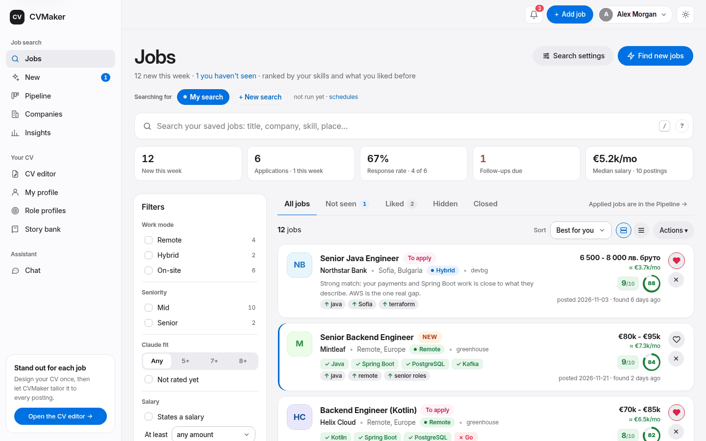

**Searching and filtering the list**: the search box takes words (all must appear, the description included), `"exact phrases"`, `-excluded` words and fields (`company:acme`, `title:`, `location:`, `skill:`, `source:`). The filters beside the list (work mode, seniority, Claude fit, salary, posting date, country, tags, source, keyword match) show how many jobs each option gives, combine freely, and update the list in place; the address always holds the current view, so it can be bookmarked, exported (CSV/XLSX export what you see) or rated with Claude as is. `/` jumps to the search box from anywhere, and the top bar suggests jobs and companies while you type.

**Dark theme**: every page, the CV editor included, follows the system theme or the toggle in the top bar.

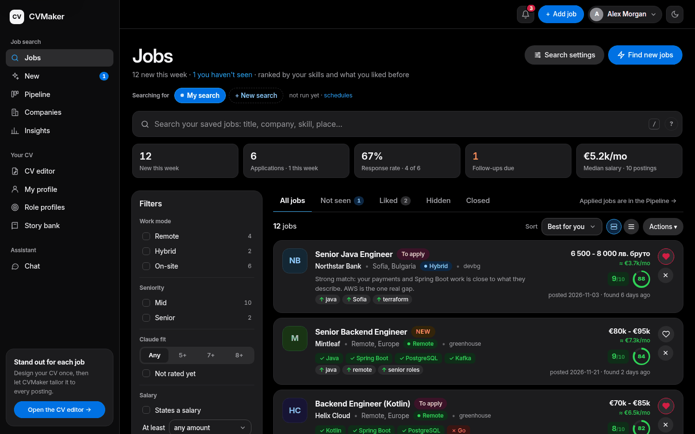

**Job page**: the posting with headings and bullets recovered, a **Next step** box, your progress, and tabs for fit, CV & letter, application, outreach, interview, offer and GitHub.

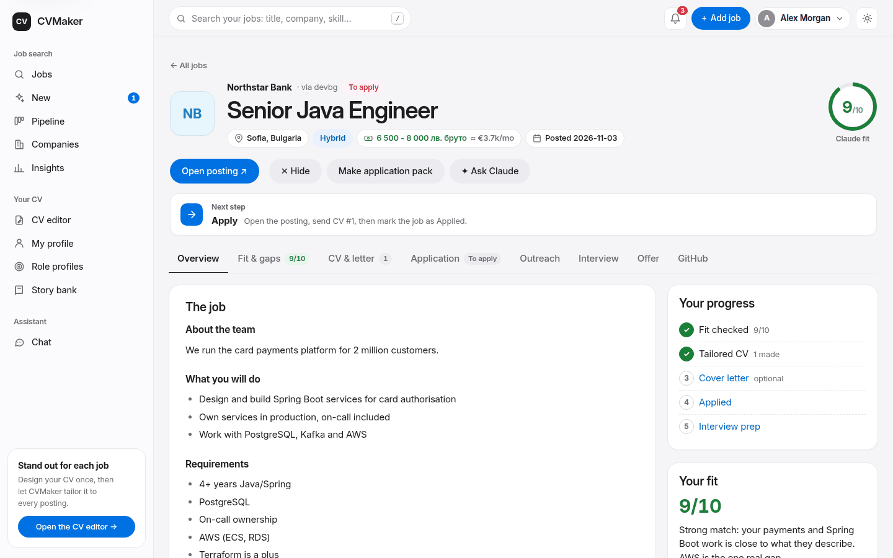

**Fit & gaps**: Claude's full fit check, with what helps you, what counts against you, and how to close each gap.

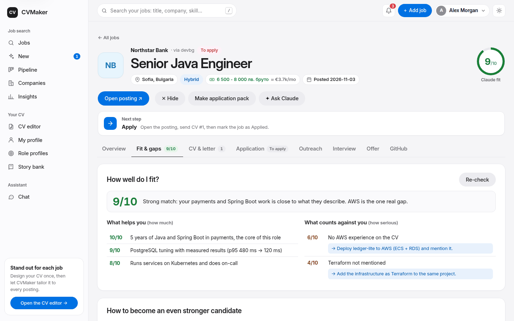

**Tailored CV**: one-page preview drawn by the CV editor, layout controls, the requirements you match and those your profile doesn't show.

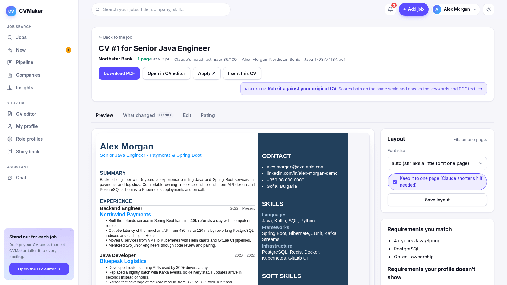

**CV editor**: click anything on the page and the toolbar changes it (font, size, colour, spacing, box size, ✦ Rewrite with Claude); templates, elements, text, uploads, layout, versions, layers and history on the left.

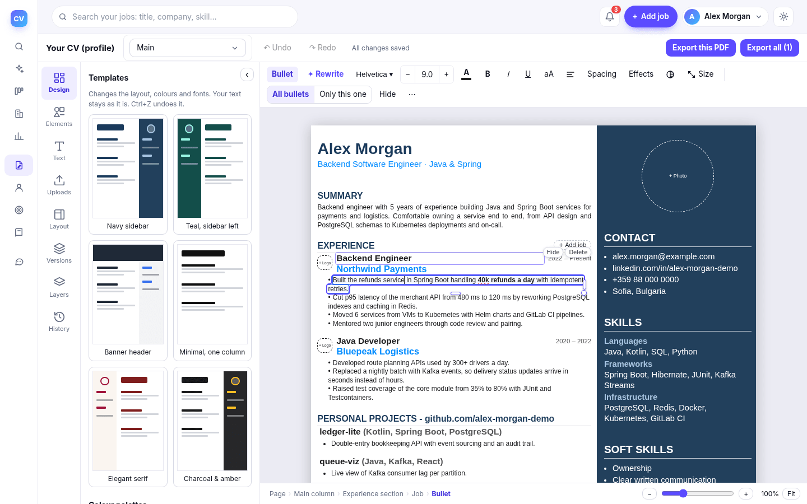

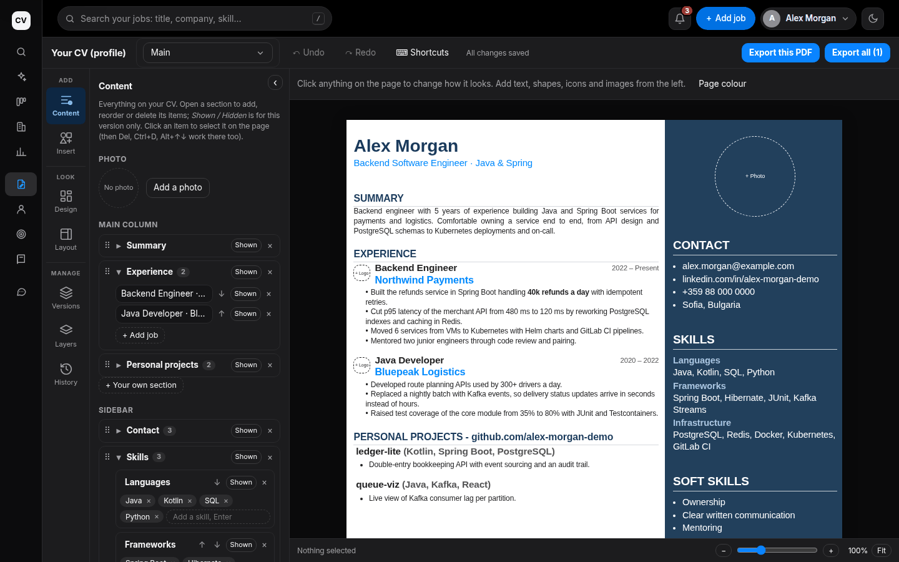

**Pipeline**: applications from To apply to Offer, Rejected or Ghosted, with response rates (with and without a tailored CV) and follow-ups due.

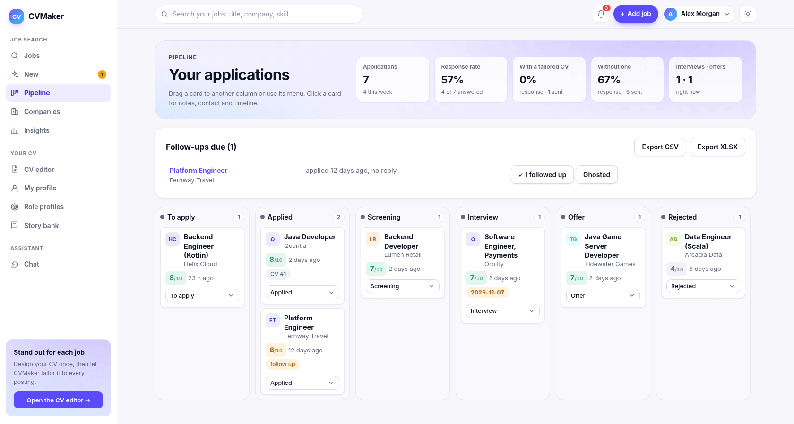

**Notifications**: new jobs, follow-ups due, closed postings and finished background tasks.

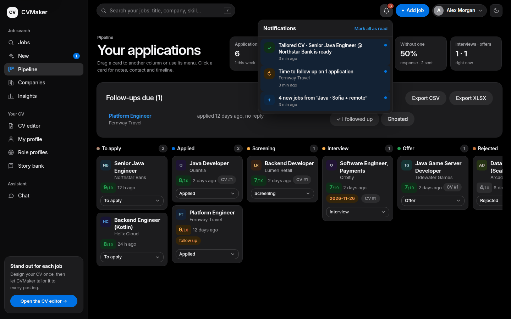

**Insights, Your gaps**: the gaps from all your fit checks grouped and ranked by how many jobs they affect, plus the skills your jobs ask for that your profile never mentions.

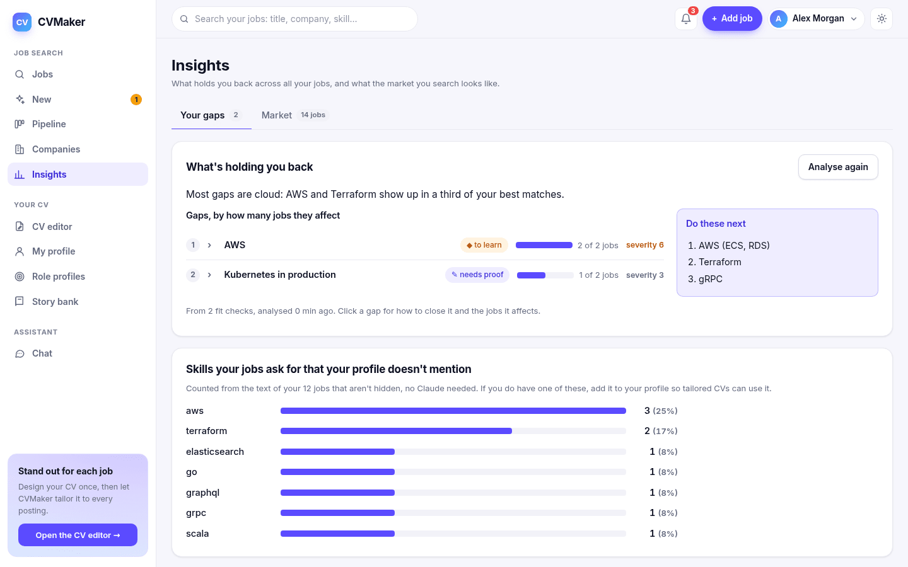

**Insights, Market**: most requested skills (and whether you have them), salaries by seniority and place, and postings per week.

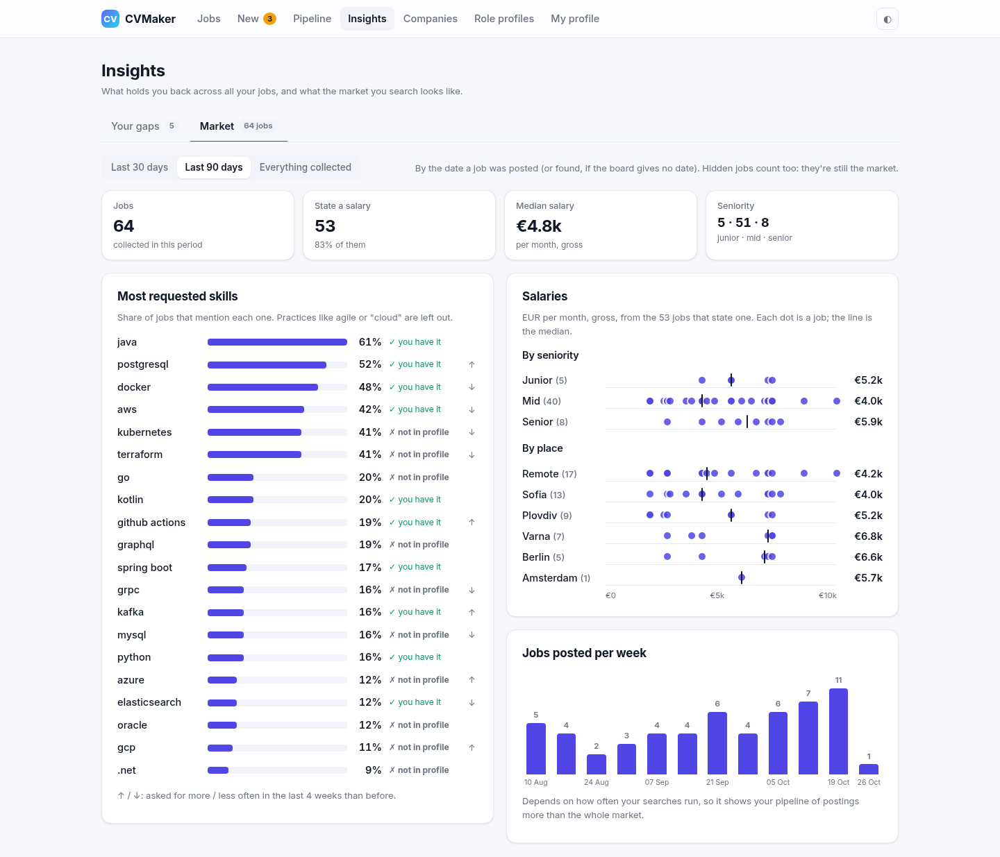

**Chat**: ask Claude about your CV or a job; profile changes are shown line by line and only saved when you apply them.

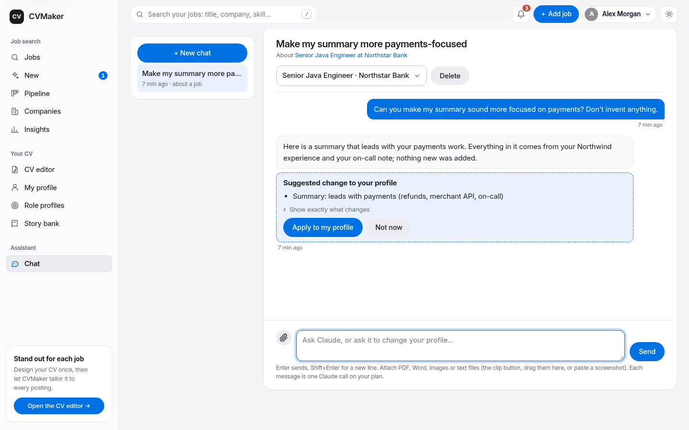

**Story bank**: STAR+R stories for interviews, drafted from your profile, with the details only you can add marked.

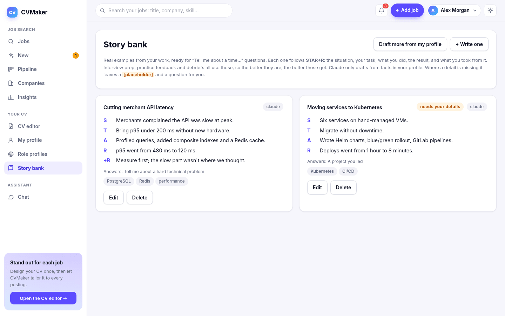

**Add a job by link or text**, then check your fit, tailor a CV or make a full application pack.

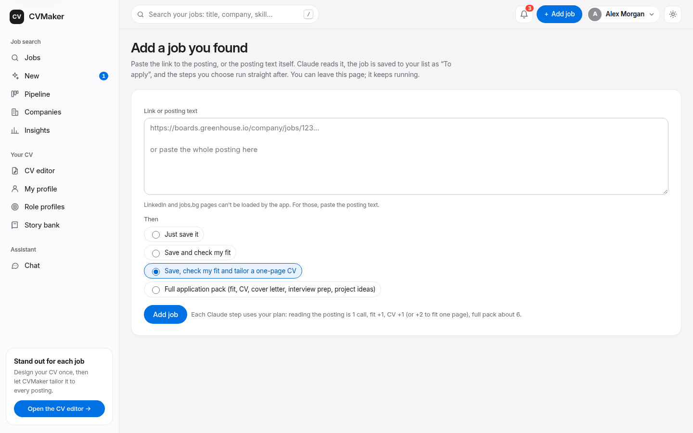

**History & backup**: restore points before profile and editor changes, and a one-zip backup of everything.

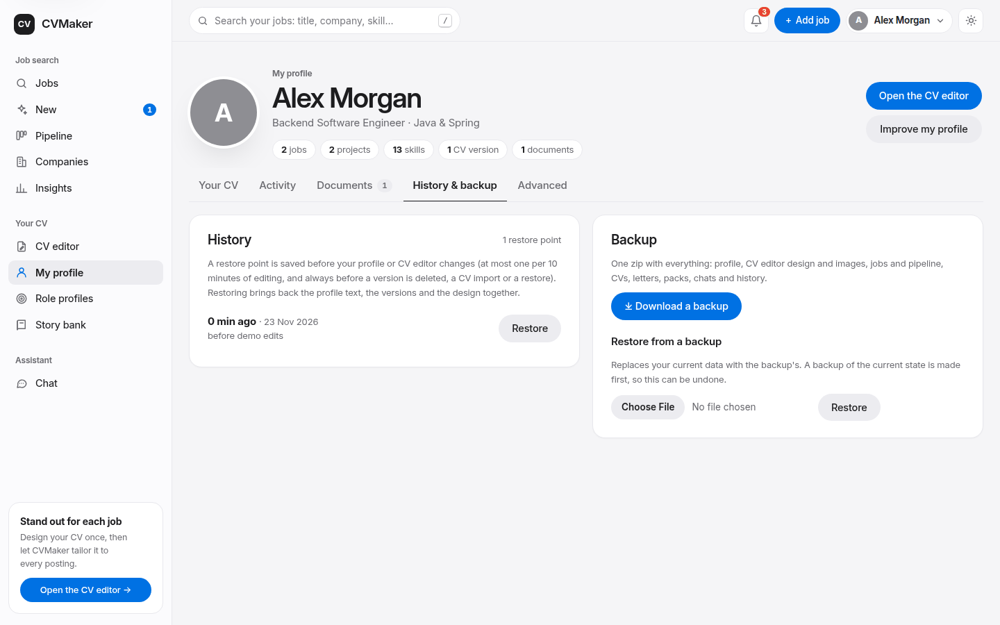
